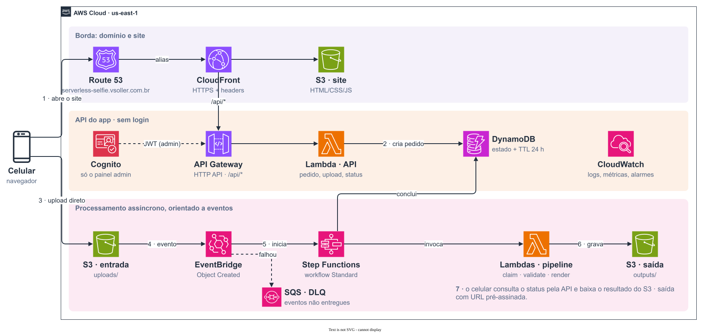
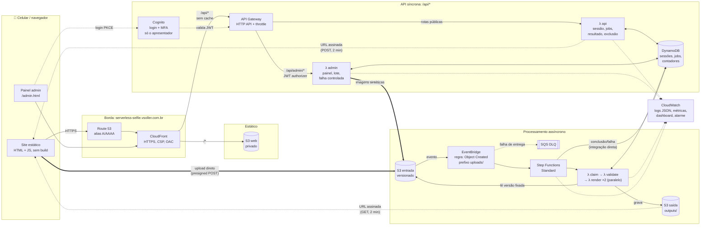
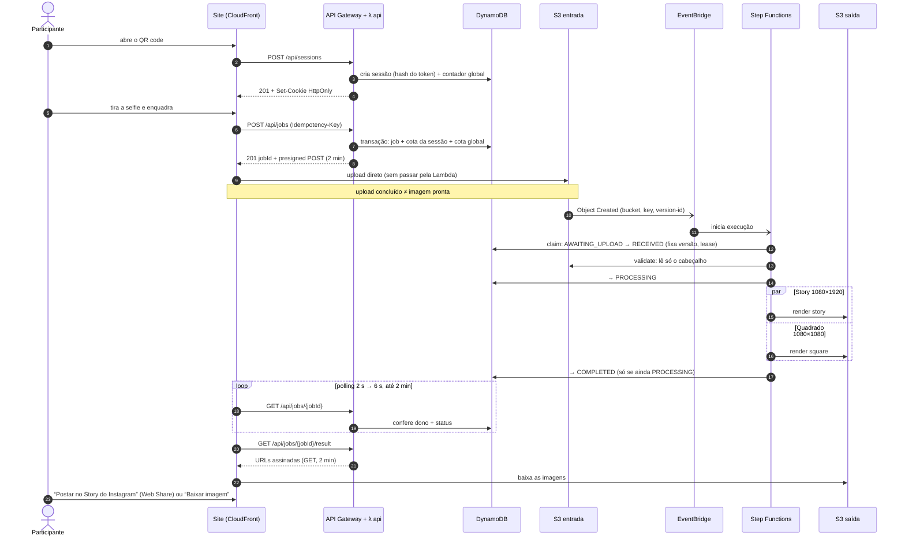
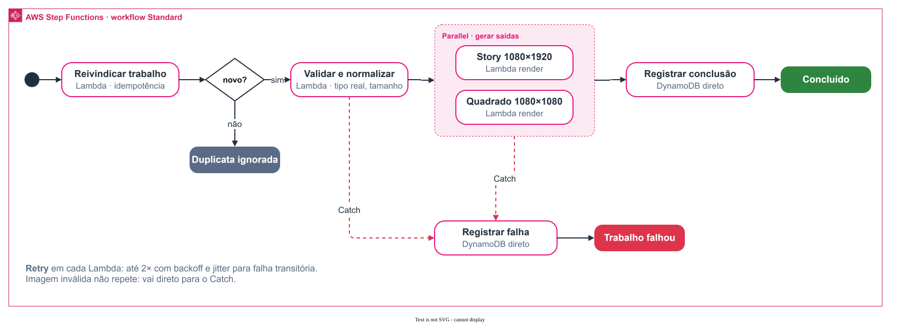
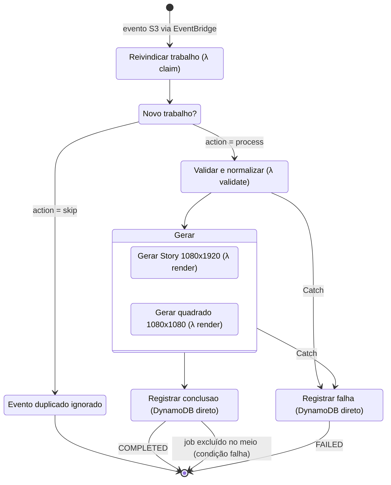
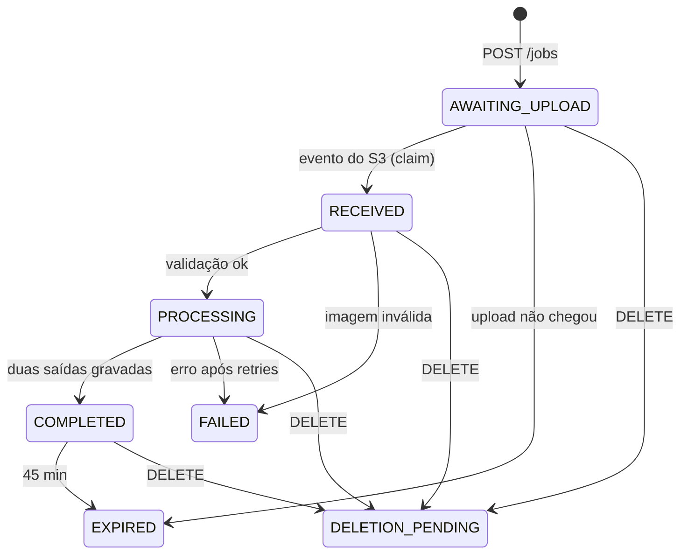

# Serverless Selfie SBG

> Sua lembrança serverless da palestra **“O que é arquitetura Serverless?”**,
> Student Builder Group IMT, 14/11/2026.

Aplicação web para celular: a pessoa tira uma selfie (ou usa a imagem de exemplo), a AWS
processa a foto de forma **assíncrona e orientada a eventos** e devolve uma moldura de foto
instantânea em dois formatos, **Story 1080×1920** e **quadrado 1080×1080**, com o botão
**“Postar no Story do Instagram”**.

A aplicação é a demo ao vivo da palestra. A turma usa e, em seguida, o apresentador abre o
console e mostra o caminho que **aquela** imagem percorreu: API → S3 → EventBridge → Step
Functions → Lambda → DynamoDB → CloudWatch.

- **App:** `https://serverless-selfie.vsoller.com.br` (depois do deploy)
- **Painel do apresentador:** `https://serverless-selfie.vsoller.com.br/admin.html` (login Cognito + MFA)
- **Materiais da palestra:** serão publicados em `vsoller.com.br/materiais/` (repositório `palestras`)

| | |
|---|---|
| Sem cadastro para quem participa | Sessão anônima por navegador, cookie `HttpOnly` |
| Sem servidor para administrar | API Gateway, Lambda, DynamoDB, S3, EventBridge, Step Functions |
| Sem segredo no repositório | IDs de conta/zona/ARNs vêm de variáveis; config do painel gerada no deploy |
| Infra como código | AWS CDK v2 em TypeScript, uma stack para a app e outra (opcional) para o OIDC do GitHub |

---

## Sumário

1. [Arquitetura](#arquitetura)
2. [O caminho de uma selfie](#o-caminho-de-uma-selfie)
3. [Workflow: idempotência, retry e falhas](#workflow-idempotência-retry-e-falhas)
4. [Estados de um trabalho](#estados-de-um-trabalho)
5. [API](#api)
6. [Modelo de dados](#modelo-de-dados)
7. [Segurança e privacidade](#segurança-e-privacidade)
8. [Limites configurados](#limites-configurados)
9. [Observabilidade e demo de escala](#observabilidade-e-demo-de-escala)
10. [Estrutura do repositório](#estrutura-do-repositório)
11. [Rodar testes e sintetizar](#rodar-testes-e-sintetizar)
12. [Deploy](#deploy)
13. [Roteiro da demo no dia](#roteiro-da-demo-no-dia)
14. [Encerramento e limpeza](#encerramento-e-limpeza)
15. [Custos](#custos)
16. [Decisões, limites conhecidos e próximos passos](#decisões-limites-conhecidos-e-próximos-passos)
17. [Referências](#referências)

---

## Arquitetura



> Diagrama em `docs/arquitetura.drawio.svg`: é um SVG com o draw.io embutido, então abre e edita direto no [draw.io](https://app.diagrams.net). A versão em Mermaid abaixo mostra o mesmo fluxo em texto.



**Três faixas, uma responsabilidade cada:**

| Faixa | Serviços | Por quê |
|---|---|---|
| Entrega do site | Route 53, CloudFront, S3 web | Site estático em bucket privado (OAC). A API fica **na mesma origem** (`/api/*`) para o cookie de sessão ser `SameSite=Strict` e dispensar CORS. |
| Pedido síncrono | API Gateway HTTP API, Lambda `api`, DynamoDB | Responde rápido: cria sessão, cria trabalho, emite autorização temporária de upload, devolve status. **Recebido não significa concluído.** |
| Processamento assíncrono | S3 entrada, EventBridge, Step Functions, Lambdas `claim`/`validate`/`render`, S3 saída | O arquivo chegou → isso é um evento → o workflow coordena as etapas, com Retry, Catch e paralelismo explícitos. |
| Transversal | CloudWatch, Cognito (só admin) | Métricas por função, logs estruturados por `jobId`, alarme da DLQ. Login com MFA só para o painel. |

**O que não está aqui, de propósito:** Cognito para participantes (a demo usa sessão anônima),
SQS no caminho principal (EventBridge + Step Functions bastam para 10 pessoas; a DLQ é só
proteção), WebSocket (polling com recuo resolve), IA, galeria pública e reconhecimento facial.

### Por que subdomínio, e não um caminho dentro de vsoller.com.br

A especificação sugeria `vsoller.com.br/labs/...`. Isso exigiria mexer na distribuição
CloudFront e no `BucketDeployment` do portfólio, que já causaram apagão de `materiais/`
(ver `palestras/CENTRAL.md`). Um subdomínio com **distribuição própria** dá o mesmo benefício
(mesma origem entre site e API) sem tocar em nenhum recurso existente, no mesmo padrão do
`deck.vsoller.com.br`. A stack só **adiciona** registros `serverless-selfie` na hosted zone.

---

## O caminho de uma selfie



---

## Workflow: idempotência, retry e falhas





- **Eventos podem repetir.** Notificações do S3 são *at-least-once* e sem ordem garantida. O
  `claim` faz uma atualização condicional: só passa o primeiro evento de um upload esperado ou
  a retomada de um processamento abandonado (lease de 5 min vencida) **da mesma versão**.
  Duplicata vira `Evento duplicado ignorado`, sem marcar o trabalho original como `FAILED`.
- **A versão do upload fica fixada.** O bucket de entrada é versionado; o primeiro evento
  válido grava o `inputVersionId` e todas as leituras usam essa versão. Reenviar outro arquivo
  com a mesma autorização não troca a imagem em processamento.
- **Retry só para o que é transitório.** Cada tarefa Lambda tem dois retriers: `InvalidImage`
  com `MaxAttempts: 0` (arquivo inválido não melhora tentando de novo) e `States.ALL` com 2
  tentativas, backoff ×2 e jitter. Depois disso, `Catch` → `Registrar falha`.
- **Saídas determinísticas.** `outputs/<jobId>/story.jpg` e `square.jpg`: repetir sobrescreve,
  não duplica. O bucket de saída não dispara eventos, então não há loop.
- **Conclusão condicional.** `Registrar conclusao` só grava se o trabalho ainda está
  `PROCESSING`; um job excluído durante o processamento não “ressuscita”.
- **Sem Lambda só para repassar chamada.** Concluir e falhar são integrações diretas
  Step Functions → DynamoDB.
- **Falha controlada (demo de Retry).** O painel cria um trabalho sintético com `failOnce`.
  A etapa *Story* falha na 1ª tentativa usando um marcador persistente no DynamoDB (não
  variável em memória), espera o Retry e conclui na 2ª. O histórico da execução mostra
  erro → espera → nova tentativa → sucesso.
- **Evento que não chega.** A regra do EventBridge tem 4 novas tentativas e uma DLQ (SQS) com
  alarme no CloudWatch. Trabalho criado e nunca enviado aparece como `EXPIRED` 5 min depois do
  vencimento da autorização de upload.

---

## Estados de um trabalho



`EXPIRED` é calculado **na leitura** (`effectiveStatus`): a aplicação nega acesso no prazo,
independentemente de quando o TTL do DynamoDB e o Lifecycle do S3 apagam fisicamente (os dois
são assíncronos e não garantem o minuto exato).

---

## API

Tudo sob `https://serverless-selfie.vsoller.com.br/api`. Respostas JSON com `Cache-Control: no-store`.
Erros: `{ "error": "CODIGO", "message": "...", "requestId": "..." }`, sem stack trace.

| Método e rota | Auth | Descrição |
|---|---|---|
| `POST /api/sessions` | — | Cria (201) ou reaproveita (200) a sessão anônima. Token só via `Set-Cookie`. Devolve `expiresAt`, `jobIds` e config pública. `403 EVENT_CLOSED`, `429 SESSION_LIMIT`. |
| `DELETE /api/sessions/current` | cookie | Revoga a sessão, apaga entradas/saídas de todos os trabalhos e expira o cookie. `202`. |
| `POST /api/jobs` | cookie | Header `Idempotency-Key` (8–64, `[A-Za-z0-9-]`). Body `{ contentType: "image/jpeg"\|"image/png", sizeBytes, focus: { x, y } }`. `201` com `jobId`, `status: AWAITING_UPLOAD` e `upload { url, fields, expiresAt }`. Mesmo pedido = mesmo trabalho (`200`, sem nova cota); mesma chave com conteúdo diferente = `409`. `413`, `429 SESSION_LIMIT`/`EVENT_LIMIT`. |
| `GET /api/jobs/{jobId}` | cookie + dono | Status, horários e `errorCode` sanitizado. Job de outra sessão = `404`. |
| `GET /api/jobs/{jobId}/result` | cookie + dono | Só `COMPLETED`. URLs assinadas (2 min) de `story` e `square`, com dimensões e MIME. |
| `DELETE /api/jobs/{jobId}` | cookie + dono | Marca `DELETION_PENDING` e apaga todas as versões de entrada e saída. `202`. |
| `GET /api/admin/dashboard` | JWT Cognito | Contagens por status (turma × sintético), durações média/p95, últimos 30 trabalhos (sem foto, sem sessão). |
| `POST /api/admin/load` | JWT Cognito | `{ count: 1..20, intervalMs: 0..2000 }`, até 25 s. Envia imagens sintéticas pelo mesmo caminho da turma. |
| `POST /api/admin/stop` | JWT Cognito | Interrompe o lote em andamento (trabalhos já aceitos continuam). |
| `POST /api/admin/retry-demo` | JWT Cognito | Cria um trabalho sintético com falha transitória programada. |
| `POST /api/admin/accepting` | JWT Cognito | `{ accepting: boolean }`: fecha/reabre a entrada de sessões e trabalhos. |
| `POST /api/admin/cleanup` | JWT Cognito | `{ scope, dryRun? }` com `scope` = `all`, `synthetic`, `15m`, `1h` ou `3h`: apaga trabalhos (arquivos e registros) do escopo; `all` também apaga sessões e zera contadores. Com `dryRun`, só conta. |

**Upload:** o navegador faz `POST` multipart direto para o S3 com os `fields` recebidos e o
arquivo por último. A política assinada exige `content-length-range` até o limite e o
`Content-Type` declarado. O S3 nunca recebe um nome de arquivo escolhido pelo cliente: a chave
é sempre `uploads/<jobId>/original`.

---

## Modelo de dados

Tabela única DynamoDB (`pk`), on-demand, TTL em `ttl`, GSI `byType` (`gsi1pk`, `createdAt`)
só para o painel.

| Item | `pk` | Campos principais |
|---|---|---|
| Sessão | `SESSION#<sha256(token)>` | `sessionId`, `createdAt`, `expiresAt`, `revokedAt?`, `jobIds[]`, `jobCount`, `ttl` |
| Trabalho | `JOB#<jobId>` | `sessionId`, `status`, `createdAt`, `updatedAt`, `expiresAt`, `uploadExpiresAt`, `contentType`, `sizeBytes`, `focusX/Y`, `inputVersionId`, `executionArn`, `receivedAt`, `completedAt`, `errorCode`, `leaseUntil`, `isSynthetic`, `failOnce?`, `failedOnce?`, `gsi1pk = "JOB"`, `ttl` |
| Evento | `META#event` | `sessions`, `jobs`, `synthetic` (contadores), `accepting`, `loadStop` |

- O **token nunca é gravado**: a chave da sessão é o hash. Quem lê a tabela não consegue se
  passar por ninguém.
- `jobId = sha256(sessionId + ":" + Idempotency-Key)[0..32]`: repetir o pedido cai no mesmo
  item. O `jobId` é referência, **não** credencial; toda leitura confere `job.sessionId`.
- Cotas por sessão e global são reservadas **na mesma transação** que cria o trabalho
  (`TransactWriteItems` com condições), então requisições simultâneas não passam do teto.
  Trabalho aceito consome cota; retry não consome outra.

---

## Segurança e privacidade

**Participantes (sem login):**
- Token de sessão de 32 bytes (CSPRNG) em cookie `HttpOnly; Secure; SameSite=Strict; Path=/api`,
  com `Max-Age` limitado ao fim do evento. Nada em `localStorage`, URL ou QR code.
- **CSRF:** toda escrita exige `Origin` igual ao domínio da app. CORS não é usado como
  autorização; o bucket aceita `POST`/`GET` só da origem da app.
- Autorização por recurso em toda rota privada; trabalho de outra sessão responde `404`
  (evita enumeração).
- O MIME declarado não vale como prova: `validate` lê o cabeçalho real (assinatura PNG/JPEG,
  dimensões) antes de decodificar, com teto de pixels e de bytes.
- Reencodar para JPEG remove EXIF, inclusive GPS. O navegador também reencoda antes do envio.
- Buckets privados (Block Public Access), SSE-S3, TLS obrigatório; imagens só por URL assinada
  de 2 minutos.
- Logs JSON com `jobId`/`requestId`; **nunca** foto, cookie, token ou URL assinada.
- Retenção: **foto e molduras em até 1 hora**. O trabalho vence em 45 min (acesso negado na
  leitura) e uma Lambda agendada a cada 10 min apaga foto e molduras (todas as versões). Fica só
  um registro anônimo (horários, status, sintético ou não; sem foto, sem token) por 30 dias, que
  alimenta o filtro de período do painel. Lifecycle do S3 e TTL do DynamoDB ficam como rede de
  segurança.
- Sem reconhecimento facial, sem galeria pública, nenhuma selfie no telão sem autorização.
- Antes de gerar, o site avisa que quem envia se responsabiliza pela imagem, que o projeto é
  educativo/de demonstração e que tudo é apagado em até 1 hora.

**Apresentador (com login):**
- Cognito User Pool **sem auto-cadastro**, senha forte e **MFA TOTP obrigatório**. O único
  usuário é criado por linha de comando (ver Deploy), então e-mail e senha nunca entram no
  repositório.
- Login pelo Managed Login do Cognito (Authorization Code + PKCE): a senha nunca passa pelo
  JS do site. Tokens no `sessionStorage`, validade de 1 h.
- Rotas `/api/admin/*` protegidas pelo **JWT authorizer do API Gateway**: sem token válido,
  a Lambda nem é invocada. A sessão anônima nunca autoriza nada administrativo.

**Borda:** CSP restritiva (sem `unsafe-inline`), HSTS, `X-Frame-Options: DENY`,
`nosniff`, throttle no stage (25 req/s, burst 50).

**Repositório público, sem segredos:** nenhum ID de conta, ARN, hosted zone, client ID ou URL
de API está versionado. A infra lê tudo de variáveis de ambiente; o painel recebe
`admin-config.json` gerado no deploy pelo próprio CDK. O deploy pelo GitHub usa **OIDC**:
nenhuma access key existe.

---

## Limites configurados

Pensados para ~10 pessoas e ensaios. Ficam em `services/common.ts` e podem ser sobrescritos
por variável de ambiente nas Lambdas.

| Limite | Valor | Variável |
|---|---|---|
| Tamanho do upload | 8 MiB | `MAX_UPLOAD_BYTES` |
| Resolução decodificada | 20 MP | `MAX_PIXELS` |
| Selfies por sessão | 3 | `JOBS_PER_SESSION` |
| Selfies no evento | 100 | `MAX_JOBS` |
| Sessões no evento | 100 | `MAX_SESSIONS` |
| Trabalhos sintéticos | 100 (lote ≤ 20) | `MAX_SYNTHETIC_JOBS` |
| Sessão | 2 h, até o fim do evento | `SESSION_SECONDS`, `EVENT_ENDS_AT` |
| Autorização de upload / URL de resultado | 2 min / 2 min | `UPLOAD_URL_SECONDS`, `RESULT_URL_SECONDS` |
| Retenção de foto e molduras | 45 min + varredura a cada 10 min (≤ 1 h) | `RETENTION_SECONDS` |
| Registro anônimo (horário, status; sem foto nem token) | 30 dias, para o filtro de período do painel | `STATS_SECONDS` |
| Logs | 7 dias | CDK |
| Polling no site | 2 s → 6 s, para em 2 min | `web/app.js` |

`EVENT_ENDS_AT` padrão: `2026-11-15T02:59:59Z` (fim do dia 14/11 em Brasília). Depois disso
nenhuma sessão nova é criada.

---

## Observabilidade e demo de escala

**Painel do apresentador (`/admin.html`):** contadores agregados **por período** (últimos 15 min, 1 h, 24 h, 7 dias ou 30 dias: sessões,
selfies da turma processadas e excluídas, sintéticos, falhas definitivas, duração ponta a ponta média e p95 do
processamento), o gráfico **Lambdas em execução ao mesmo tempo** (por minuto, últimos 15 min,
com pico × limite da conta, throttles e invocações, lidos do CloudWatch), tabela dos
últimos trabalhos com link direto para a **execução no Step Functions**, atalhos para S3,
DynamoDB e o dashboard, e os botões **Executar lote de demonstração**, **Parar lote**,
**Demonstrar recuperação** e **Encerrar entrada**. Sem fotos e sem dados pessoais: pode ir
para o telão.

**Dashboard CloudWatch `serverless-selfie-sbg`** (provisionado no CDK), por função
(`api`, `admin`, `claim`, `validate`, `render`):

| Widget | Estatística | Como ler |
|---|---|---|
| `Invocations` | Sum | Volume. Inclui polling, etapas e retries; não é número de selfies. |
| `ConcurrentExecutions` | **Maximum** | Simultaneidade real. Só esta métrica prova trabalho em paralelo. |
| `Duration` | Average e p95 | Tempo de execução da função; **não** é o tempo percebido nem inclui cold start. |
| `Errors` | Sum | Tentativas que falharam, mesmo quando o trabalho terminou bem depois do Retry. |
| `Throttles` | Sum | Pedidos limitados por concorrência. |
| Workflow | iniciadas / concluídas / falharam | Execuções ≠ trabalhos únicos (duplicatas também iniciam execução). |
| DLQ | mensagens visíveis | Evento que não chegou ao workflow (com alarme). |

As métricas padrão da Lambda saem em intervalos de 1 minuto: espere ~1–2 min depois do lote.

---

## Estrutura do repositório

```text
infra/
  app.ts              entrada do CDK: lê variáveis, instancia as stacks
  selfie-stack.ts     toda a aplicação (dados, Lambdas, workflow, API, CDN, Cognito, dashboard)
  oidc-stack.ts       papel IAM para o GitHub Actions (opcional)
services/
  common.ts           clientes AWS, limites, chaves do DynamoDB, helpers HTTP e log
  api.ts              λ api: sessões, trabalhos, resultado, exclusão · λ sweep: apaga o vencido (10 min)
  admin.ts            λ admin: painel, lote sintético, falha controlada, abrir/fechar entrada
  pipeline.ts         λ claim / validate / render (tarefas do Step Functions)
  image.ts            leitura de cabeçalho, recorte, composição (Jimp, JS puro)
  assets/             molduras PNG + frames.json (gerados por scripts/build-frames.mjs)
web/
  index.html app.js   site público (vanilla, sem build)
  custos.html custos.js  calculadora de custo por selfie (consumo medido × preço oficial)
  admin.html admin.js painel com login Cognito (PKCE)
  style.css           paleta e tipografia da palestra
  sample.jpg          imagem de exemplo (ilustração própria, sem rosto)
scripts/
  build-frames.mjs    gera molduras e imagem de exemplo (identidade SBG, JetBrains Mono/Manrope)
  cleanup.mjs         limpeza pós-evento com dry-run
tests/                node:test: imagem/estados + assertions do template CDK
.github/workflows/    ci.yml (typecheck, testes, synth) e deploy.yml (manual, OIDC)
```

Dependências de runtime: só o AWS SDK v3 e o **Jimp** (processamento de imagem em JavaScript
puro). Nenhum binário nativo para compilar para a Lambda ARM.

---

## Rodar testes e sintetizar

Requer Node.js 22+.

```bash
npm ci
npm run typecheck
npm test                                  # imagem, estados e assertions de segurança do template
HOSTED_ZONE_ID=Z000000EXAMPLE npm run cdk:synth   # sem credenciais, valores fictícios
```

Para mudar a moldura (texto, cores, arte do grupo), edite `scripts/build-frames.mjs` e rode
`npm run frames`. Os PNG gerados são versionados; a Lambda só compõe PNG + foto.

---

## Deploy

O deploy é feito **só pelo GitHub Actions**, autenticado por OIDC: não existe access key, e
nenhum ID de conta, zona ou ARN fica no código. Esses valores ficam em **Variables** do
repositório (*Settings → Secrets and variables → Actions*), lidos pelo workflow como
`${{ vars.NOME }}`. Localmente, o `.env` (ignorado pelo git) serve apenas para `cdk diff`.

### Pré-requisitos (já atendidos na conta)

- `cdk bootstrap` feito em `us-east-1`.
- Provedor OIDC do GitHub (`token.actions.githubusercontent.com`) cadastrado no IAM.
- Hosted zone de `vsoller.com.br` no Route 53.

### Configuração do repositório

| Onde | Nome | Conteúdo |
|---|---|---|
| **Secret** | `AWS_DEPLOY_ROLE_ARN` | ARN do papel `github-actions-serverless-selfie-deploy` |
| Variable | `REPO_OIDC_CLAIM` | claim imutável do repo: `gh api repos/VgsStudio/serverless-selfie-sbg --jq '"\(.owner.login)@\(.owner.id)/\(.name)@\(.id)"'` |

Mais o ambiente **`event`** (*Settings → Environments*), restrito à branch `main`. Dá para
exigir aprovação manual nele.

O ARN do papel é **secret** porque contém o ID da conta e, em repositório público, **os logs do
Actions também são públicos**: secrets aparecem como `***`, variables não. O workflow ainda
liga `mask-aws-account-id` para o ID da conta não vazar em saídas do CDK. A hosted zone **não
precisa de ID**: o CDK descobre a zona pelo nome (`HostedZone.fromLookup`) durante o deploy.
Nenhum desses valores dá acesso a nada sozinho; a confiança está na política OIDC do papel,
restrita à branch `main` **deste** repositório.

### Primeira vez: criar o papel do GitHub (uma única vez)

O GitHub só consegue assumir o papel depois que ele existe, então ele precisa ser criado uma
vez por alguém com acesso à conta. É a única ação fora do Actions, e cria só um papel IAM:

```bash
# .env com HOSTED_ZONE_ID e GITHUB_REPO_CLAIM (ver .env.example)
npx cdk deploy ServerlessSelfie-Oidc
```

A partir daí, o próprio workflow mantém esse papel (`cdk deploy --all`).

### Rodar o deploy

*Actions → Deploy → Run workflow* (ou `gh workflow run Deploy`). O workflow não dispara em
push: deploy de evento ao vivo é decisão humana. Ele roda os testes e depois o `cdk deploy`.

No primeiro deploy, o certificado ACM é emitido e validado por DNS dentro da própria stack, o
que leva alguns minutos. Nada do site principal é alterado; a stack só cria os registros
`serverless-selfie` na zona.

O workflow **CI** roda em todo PR e push: typecheck, testes e `cdk synth` com valores
fictícios, sem credenciais.

### Criar o usuário do painel

O pool não aceita cadastro. Crie o único usuário pela CLI (o e-mail fica só na AWS):

```bash
POOL_ID=$(aws cloudformation describe-stacks --stack-name ServerlessSelfie-App   --query "Stacks[0].Outputs[?OutputKey=='UserPoolId'].OutputValue" --output text)

aws cognito-idp admin-create-user --user-pool-id "$POOL_ID"   --username "<seu-email>"   --user-attributes Name=email,Value="<seu-email>" Name=email_verified,Value=true   --desired-delivery-mediums EMAIL
```

O Cognito envia uma senha temporária por e-mail. No primeiro acesso a `/admin.html`, você
define a senha definitiva e cadastra o app autenticador (TOTP).

### Cota de concorrência da Lambda

Contas novas começam com **10** execuções simultâneas (o padrão é 1000). O workflow já tem
retry específico para `Lambda.TooManyRequestsException`, mas um lote de 20 trabalhos fica
lento. Antes do evento, peça o aumento em *Service Quotas → AWS Lambda → Concurrent
executions* (gratuito).

### Rollback

O site é versionado no git: `git revert` + deploy. A stack do CloudFormation desfaz sozinha um
deploy que falhou. Para tirar a app do ar sem apagar nada, use **Encerrar entrada** no painel.

---

## Roteiro da demo no dia

Antes (com antecedência):
- [ ] Deploy feito, `https://serverless-selfie.vsoller.com.br` testado em **Safari/iPhone** e **Chrome/Android**, incluindo o botão de Story e o fallback de download.
- [ ] Login no painel testado (senha + TOTP).
- [ ] Ensaio: uma selfie, um lote de 20 e a falha controlada; anotar duração real e atraso das métricas.
- [ ] Abas abertas: app, painel, Step Functions, S3 entrada, DynamoDB, dashboard CloudWatch.
- [ ] Gravação do fluxo feliz, do retry e do painel como contingência (identificada como gravação).
- [ ] `npm run event:cleanup -- --yes` depois do ensaio, para zerar contadores e imagens.

Durante (slide 18, ~14 min):
1. **Turma gera a selfie:** QR na tela, o apresentador faz junto no próprio celular.
2. **Caminho de uma imagem:** com a **própria** foto, copiar o `jobId` no painel → abrir a
   execução no Step Functions → objeto no S3 de entrada → item no DynamoDB.
3. **Trabalho simultâneo:** *Executar lote de demonstração* (20 trabalhos, 500 ms). Mostrar os
   sintéticos separados da turma no painel.
4. **Recuperação de falha:** *Demonstrar recuperação* → histórico da execução: erro
   `DemoTransientError` → espera do Retry → nova tentativa → sucesso. Avisar que a falha é
   provocada.
5. **Interpretar:** dashboard CloudWatch, `ConcurrentExecutions` (Maximum) no período do lote.
   Se as métricas atrasarem, voltar ao workflow e retomar no fim.

Regra de contingência: não depurar no palco por mais de 2 minutos. Câmera falhou → imagem de
exemplo. Compartilhar falhou → baixar. Tudo falhou → gravação, dita como gravação.

---

## Encerramento e limpeza

1. **Painel → Encerrar entrada.** Novas sessões e trabalhos param na hora; trabalhos já
   aceitos terminam normalmente.
2. Em até 1 hora tudo é apagado sozinho (vencimento em 45 min + varredura a cada 10 min).
3. Para apagar antes: **Painel → Limpar dados**, escolhendo o escopo:
   - **Tudo**: selfies, sessões e contadores. É o que deixa o painel zerado para a palestra.
   - **Só os sintéticos**: some com os lotes e a falha controlada do ensaio.
   - **Criados há mais de 15 min / 1 h / 3 h**: preserva o que acabou de acontecer.

   O painel mostra antes quantos itens vai apagar e pede confirmação. Apaga fotos e molduras
   (todas as versões) e os registros, só **desta stack**. Pela linha de comando, o equivalente a
   "Tudo" é `npm run event:cleanup` (dry-run) e `npm run event:cleanup -- --yes`.
4. Para remover tudo: `npx cdk destroy ServerlessSelfie-App`. Buckets, tabela e user pool desta
   demo estão com remoção automática; nenhum recurso do site principal é afetado.

---

## Custos

Calculadora pública: **`/custos.html`**. Resumo para slides em [`docs/custos.md`](docs/custos.md). Estimativa equivalente no AWS Pricing Calculator (1.000 selfies/mês): https://calculator.aws/#/estimate?id=f75a703d88fde696f77f23321068d3b027857b1e . Ela cruza o **consumo medido no ensaio** (CloudWatch,
26 execuções) com os **preços oficiais de us-east-1** (AWS Price List API, 10/11/2026), sem
Free Tier e sem créditos, ou seja, o preço cheio.

| | |
|---|---|
| **Média por selfie** | **≈ US$ 0,0004** (4 centésimos de centavo de dólar) |
| 100 selfies | ≈ US$ 0,04 |
| Maior fatia | **Step Functions (~50%)**: 8 transições × US$ 0,000025 |
| Segunda | Lambda de render (~25%): 2 × ~1,9 s × 2 GB |

O resto (S3, transferência, CloudFront, DynamoDB, API Gateway, logs) soma o último quarto.
Um bom gancho para a palestra: o custo dominante é a **orquestração**, não o processamento de
imagem. Num volume alto, um workflow **Express** ou menos estados mudariam essa conta.

Ficam de fora os custos fixos, que não dependem de selfie: o dashboard do CloudWatch (US$ 3/mês;
os 3 primeiros da conta são grátis) e o alarme (US$ 0,10/mês). **Serverless não é sinônimo de
grátis**: com créditos a fatura pode vir zerada, mas o consumo existe. Crie um alerta no AWS
Budgets antes do evento (alerta não é teto de cobrança) e use **Encerrar entrada** + limpeza ao
final.

---

## Decisões, limites conhecidos e próximos passos

- **Stories do Instagram:** um site não consegue abrir o editor de Stories com a mídia. O botão
  usa a Web Share API (`navigator.canShare({ files })` + `navigator.share`) com o arquivo já
  baixado antes do toque; quem escolhe os apps é o sistema operacional. Sem suporte, o site
  salva a imagem e orienta “abra o Instagram, crie um Story e escolha a imagem”. Nada é
  publicado automaticamente e nada confirma postagem. **Validar em aparelhos reais antes do
  evento.**
- **HEIC:** o navegador reencoda a foto para JPEG antes do envio. Safari abre HEIC; se outro
  navegador não abrir, o site pede JPEG/PNG ou oferece a imagem de exemplo.
- **Arte oficial do grupo:** ainda não autorizada, então a moldura usa só texto (título, grupo,
  data) e a paleta. Quando chegar, entra em `scripts/build-frames.mjs`.
- **Reconciliação:** não há rotina agendada; trabalho sem upload vira `EXPIRED` na leitura,
  processamento abandonado é retomado por lease e evento perdido cai na DLQ com alarme.
  Suficiente para uma demo de 10 pessoas; para produção, uma regra agendada que reprocessa
  `RECEIVED`/`PROCESSING` parados.
- **Painel lê todos os trabalhos pelo GSI** (≤ ~200 itens). Para volume real, agregados
  mantidos em contadores.
- **Endpoint `execute-api` padrão** continua acessível fora do CloudFront. Sem o cookie
  (host-only do domínio da app) e com checagem de `Origin`, não há acesso a dados; o throttle
  do stage limita abuso. Para fechar de vez: domínio customizado na API +
  `disableExecuteApiEndpoint`.
- **Concorrência da Lambda:** contas novas podem ter limite baixo de execuções simultâneas.
  Conferir a quota antes do lote; throttles entram no Retry do workflow.
- **XSS e o painel:** site e painel dividem a origem. Por isso a CSP não permite script inline
  nem de terceiros, e todo texto dinâmico é inserido com `textContent`.

---

## Referências

- [AWS: S3 → EventBridge → Step Functions](https://docs.aws.amazon.com/step-functions/latest/dg/tutorial-cloudwatch-events-s3.html)
- [AWS: notificações do S3, entrega duplicada e loops](https://docs.aws.amazon.com/AmazonS3/latest/userguide/notification-how-to-event-types-and-destinations.html)
- [AWS: tipos de métricas da Lambda](https://docs.aws.amazon.com/lambda/latest/dg/monitoring-metrics-types.html) e [publicação em intervalos de 1 minuto](https://docs.aws.amazon.com/lambda/latest/dg/monitoring-metrics.html)
- [AWS: JWT authorizers no HTTP API](https://docs.aws.amazon.com/apigateway/latest/developerguide/http-api-jwt-authorizer.html)
- [AWS: Free Tier e créditos](https://aws.amazon.com/blogs/aws/aws-free-tier-update-new-customers-can-get-started-and-explore-aws-with-up-to-200-in-credits/)
- [MDN: Web Share API](https://developer.mozilla.org/en-US/docs/Web/API/Web_Share_API), [`navigator.canShare`](https://developer.mozilla.org/en-US/docs/Web/API/Navigator/canShare), [`navigator.share`](https://developer.mozilla.org/en-US/docs/Web/API/Navigator/share)
- Case público citado na palestra: [Serverlesspresso](https://github.com/aws-samples/serverless-coffee)

Fontes JetBrains Mono e Manrope: SIL Open Font License, via Google Fonts. Paleta, grade,
mosaico e ícone do chip vêm do template oficial do AWS Student Builder Group. A aplicação não é produto
oficial nem tem endosso do Student Builder Group ou da AWS.
